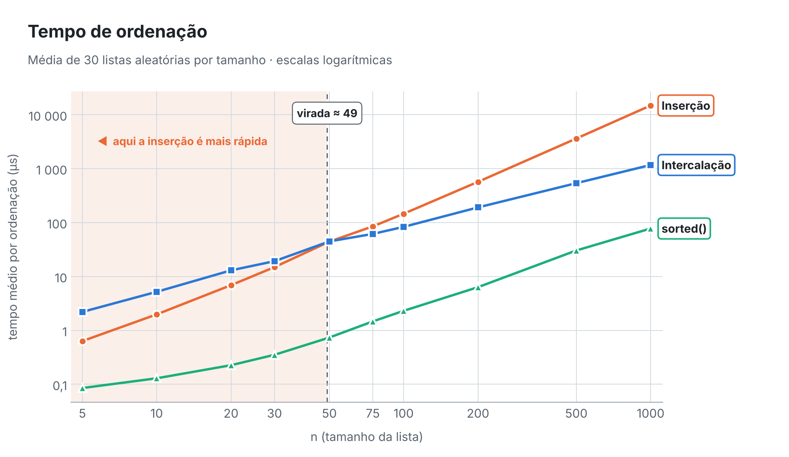
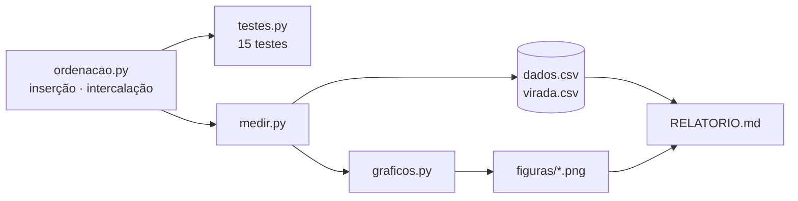

<div align="center">



<br>

[](https://github.com/Arthur-Gmb/insercao-vs-intercalacao/actions/workflows/testes.yml)


**Implementação e comparação experimental da ordenação por inserção e da ordenação por intercalação,<br>com o `sorted()` do Python como referência.**

[**📊 Ler o relatório**](RELATORIO.md) · [Como rodar](#-como-rodar) · [Resultados](#-resultados-em-uma-tela) · [Estrutura](#-o-que-tem-aqui) · [Testes](#-testes)

</div>

---

## ✨ Resultados em uma tela

<table>
<tr>
<td align="center" width="25%">
<h3>n ≈ 49</h3>
a partir daqui a <b>intercalação</b><br>é mais rápida no relógio
</td>
<td align="center" width="25%">
<h3>n = 4</h3>
a partir daqui ela já faz<br><b>menos comparações</b>
</td>
<td align="center" width="25%">
<h3>12,7×</h3>
mais rápida que a inserção<br>em <b>n = 1000</b>
</td>
<td align="center" width="25%">
<h3>+1,5%</h3>
comparações do <code>sorted()</code> acima do<br><b>mínimo teórico</b> log₂(n!) em n = 1000
</td>
</tr>
</table>

<picture>
  <source media="(prefers-color-scheme: dark)" srcset="figuras/tempos-escuro.png">
  
</picture>

> [!NOTE]
> **Por que os dois pontos de virada são tão diferentes?** Cada comparação da intercalação custa 2,3 a 3 vezes mais em Python, por causa da recursão e das cópias de lista. A explicação completa, os outros gráficos e as tabelas estão no **[relatório](RELATORIO.md)**.

---

## 🚀 Como rodar

Precisa de **Python 3.8 ou mais novo**. Os testes usam só a biblioteca padrão; os gráficos usam o matplotlib.

```bash
git clone https://github.com/Arthur-Gmb/insercao-vs-intercalacao.git
cd insercao-vs-intercalacao
pip install -r requirements.txt
```

| Comando | O que faz | Tempo |
|---|---|---|
| `python testes.py` | roda os 15 testes | < 1 s |
| `python medir.py` | apaga e refaz `dados.csv`, `virada.csv` e todos os gráficos de `figuras/` | ~10 s |

<details>
<summary><b>Saída esperada do <code>python medir.py</code></b></summary>

```text
Inserção × Intercalação — medições

  tamanhos do enunciado  [████████████████████████████] 10/10
  varredura fina         [████████████████████████████] 119/119
  gráficos... ok

Tempo médio (µs)

| n | Inserção | Intercalação | sorted() |
|---:|---:|---:|---:|
| 5 | 0,6 | 2,2 | 0,1 |
| 10 | 2,0 | 5,2 | 0,1 |
...
| 1000 | 14 835,7 | 1 169,4 | 77,5 |

Ponto de virada (intercalação passa a vencer e não perde mais):
  tempo,       varredura fina:        n = 49
  comparações, varredura fina:        n = 5
...
```

Os tempos mudam de máquina para máquina. As comparações saem **idênticas** em qualquer computador, porque as listas são geradas com semente fixa.

</details>

> [!TIP]
> No Windows, se `python` não for reconhecido, use `py testes.py` e `py medir.py`.

---

## 📁 O que tem aqui

```text
insercao-vs-intercalacao/
├── ordenacao.py        os dois métodos de ordenação
├── testes.py           testes que provam que ordenam certo
├── medir.py            roda tudo e gera o CSV e os gráficos
├── graficos.py         desenho dos gráficos (usado pelo medir.py)
├── dados.csv           números brutos das medições
├── virada.csv          números brutos da varredura fina (n = 2 a 120)
├── RELATORIO.md        a análise
├── README.md           como rodar (este arquivo)
├── figuras/            gráficos em versão clara e escura + banner
└── .github/workflows/  testes automáticos a cada push
```



<details>
<summary><b>Formato do <code>dados.csv</code></b></summary>

Uma linha por **tamanho × repetição × algoritmo** (900 linhas):

| coluna | significado |
|---|---|
| `n` | tamanho da lista |
| `repeticao` | 1 a 30 (cada repetição é uma lista aleatória nova) |
| `algoritmo` | `insercao`, `intercalacao` ou `sorted` |
| `tempo_ns` | tempo de uma ordenação, em nanossegundos |
| `comparacoes` | comparações entre elementos feitas nessa ordenação |
| `execucoes` | quantas vezes a ordenação foi repetida para medir o tempo (listas pequenas são rápidas demais para medir uma vez só) |

</details>

---

## 🧪 Testes

`python testes.py` roda **15 testes** sobre as **quatro** funções (as duas ordenações e as duas versões que contam comparações):

| Caso | O que garante |
|---|---|
| ✅ Lista vazia | devolve `[]` sem erro |
| ✅ Um elemento só | devolve a mesma lista |
| ✅ Todos os elementos iguais | lida com repetidos sem erro |
| ✅ Lista já ordenada | continua ordenada |
| ✅ Lista invertida | o pior caso da inserção |
| ✅ Dois elementos, negativos, repetidos, `float`, `str` | funciona com qualquer tipo comparável |
| ✅ Listas aleatórias de 0 a 39, 100, 257 e 1000 elementos | resultado igual ao `sorted()` |
| ✅ Estabilidade | elementos iguais mantêm a ordem original |
| ✅ Não altera a entrada | a lista recebida fica intacta |
| ✅ Contagem confere com um "espião" | o contador bate com cada `<` e `>` realmente executado |
| ✅ Melhor e pior caso da inserção | exatamente n − 1 e n(n − 1)/2 comparações |
| ✅ Intercalação em lista ordenada | exatamente (n/2)·log₂ n comparações para n = 2ᵏ |

Os testes também rodam automaticamente no GitHub a cada `push`, em **Windows, macOS e Linux**, com Python 3.9 e 3.13. O selo **testes** no topo mostra o resultado.

---

## 🧠 Os algoritmos

<table>
<tr>
<th width="50%">Inserção</th>
<th width="50%">Intercalação</th>
</tr>
<tr>
<td>

```python
def insercao(lista):
    a = list(lista)
    for i in range(1, len(a)):
        chave = a[i]
        j = i - 1
        while j >= 0 and a[j] > chave:
            a[j + 1] = a[j]
            j -= 1
        a[j + 1] = chave
    return a
```

</td>
<td>

```python
def intercalacao(lista):
    if len(lista) <= 1:
        return list(lista)
    meio = len(lista) // 2
    esq = intercalacao(lista[:meio])
    dir = intercalacao(lista[meio:])
    return _intercalar(esq, dir)
```

</td>
</tr>
<tr>
<td>

**Melhor caso** O(n) · **médio e pior** O(n²)<br>
memória extra O(1) · estável

</td>
<td>

**Todos os casos** O(n log n)<br>
memória extra O(n) · estável

</td>
</tr>
</table>

---

## 👥 Autores

<table>
<tr>
<td align="center" width="200">
<a href="https://github.com/Arthur-Gmb"><br><b>Arthur Gabriel Monteiro Barreiras</b></a><br>@Arthur-Gmb
</td>
<td align="center" width="200">
<a href="https://github.com/fink1722"><br><b>Cauã Evaristo da Cruz</b></a><br>@fink1722
</td>
</tr>
</table>

Trabalho em dupla · Ciência da Computação · Estrutura de Dados Avançadas · 2026

<sub>Distribuído sob a [licença MIT](LICENSE).</sub>ação · Estrutura de Dados Avançadas · 2026

<sub>Distribuído sob a [licença MIT](LICENSE).</sub>
