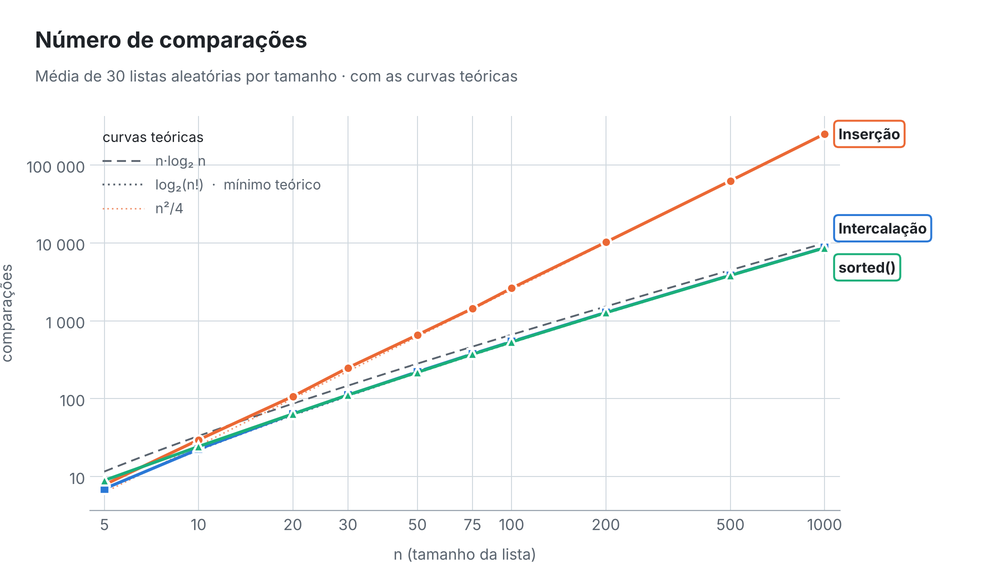
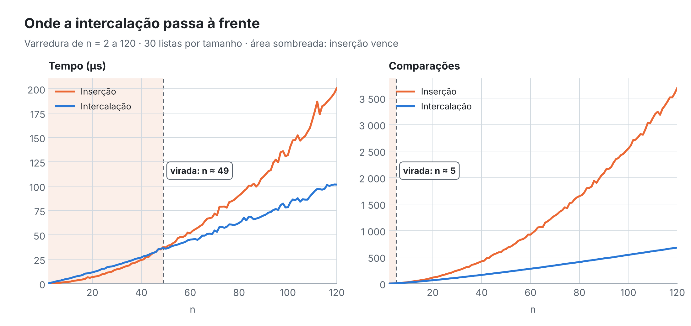

<div align="center">

# 📊 Relatório — Inserção × Intercalação

**Ordenação por inserção · ordenação por intercalação · `sorted()` do Python**

[Método](#-como-foi-medido) ·
[Tempos](#-tempos) ·
[Comparações](#-comparações) ·
[Ponto de virada](#-em-que-n-a-intercalação-passa-a-ser-mais-rápida) ·
[Por que os pontos diferem](#-o-gráfico-de-comparações-dá-o-mesmo-ponto-de-virada) ·
[sorted()](#-por-que-o-sorted-não-serve-para-decidir) ·
[Quando usar inserção](#-quando-a-inserção-ainda-é-a-escolha-certa) ·
[Extra](#-extra-quantas-comparações-o-sorted-faz)

</div>

---

## 🔑 Resumo

| Pergunta | Resposta |
|---|---|
| A partir de que n a intercalação é mais rápida? | **n ≈ 49** (empate técnico em n = 50; vence sempre a partir de n = 75 na grade do enunciado) |
| E pelo número de comparações? | **n = 4** — praticamente desde o início |
| Por que os dois pontos diferem? | Cada comparação da intercalação custa **2,3 a 3 vezes mais** em Python (recursão, cópias, alocação) |
| Quanto a intercalação ganha em n = 1000? | **12,7 vezes** mais rápida; faz **29 vezes** menos comparações |
| O `sorted()` decide a disputa? | Não: é outro algoritmo (Timsort), escrito em C |
| Quando a inserção ainda é a melhor? | Listas **pequenas** ou **quase ordenadas** |
| Extra: comparações do `sorted()` | Só **1,5% a 4%** acima do mínimo teórico $\log_2(n!)$ para n ≥ 20 |

---

## 🔬 Como foi medido

| Item | Escolha | Por quê |
|---|---|---|
| Entradas | inteiros aleatórios entre 0 e 10·n | poucos repetidos, caso médio |
| Repetições | **30 listas por tamanho** (mínimo pedido: 10) | média estável |
| Semente | `2026` fixa | `python medir.py` gera sempre as mesmas listas |
| Mesma lista | os três algoritmos ordenam **a mesma lista** em cada repetição, em ordem sorteada | comparação justa, sem favorecer quem roda primeiro |
| Relógio | `time.perf_counter_ns()` com o coletor de lixo desligado | maior resolução disponível |
| Listas pequenas | cada medida roda o algoritmo $k = \max(1, \lfloor 1000/n \rfloor)$ vezes e divide por $k$ | uma lista de 5 elementos ordena em menos de 1 µs, perto da resolução do relógio |
| Comparações | versões separadas que contam (`insercao_contando`, `intercalacao_contando`) | a contagem não atrapalha a medição de tempo |

> [!NOTE]
> **As comparações são exatas e reproduzíveis**: dependem só das listas, que são sempre as mesmas. **Os tempos dependem da máquina.** Os números abaixo são de uma execução em Python 3.13 / Linux / Intel Xeon 2,30 GHz. Ao rodar `python medir.py` em outro computador, os valores absolutos mudam, mas as proporções e conclusões se mantêm.

Os testes (`python testes.py`) conferem, com uma classe espiã que conta cada `<` e `>` executado, que o contador interno bate exatamente com as comparações realmente feitas.

---

## ⌛ Tempos

Tempo médio de **uma** ordenação, em microssegundos. Em **negrito**, o mais rápido entre inserção e intercalação.

| n | Inserção | Intercalação | `sorted()` | Intercalação ÷ Inserção |
|---:|---:|---:|---:|---:|
| 5 | **0,6** | 2,2 | 0,1 | 3,7× mais lenta |
| 10 | **2,0** | 5,2 | 0,1 | 2,6× mais lenta |
| 20 | **6,9** | 13,0 | 0,2 | 1,9× mais lenta |
| 30 | **14,9** | 19,2 | 0,4 | 1,3× mais lenta |
| 50 | **44,2** | 44,6 | 0,7 | empate |
| 75 | 84,8 | **61,5** | 1,5 | 1,4× mais rápida |
| 100 | 145,7 | **83,2** | 2,3 | 1,8× mais rápida |
| 200 | 569,2 | **191,0** | 6,3 | 3,0× mais rápida |
| 500 | 3 619,8 | **537,5** | 30,3 | 6,7× mais rápida |
| 1000 | 14 835,7 | **1 169,4** | 77,5 | 12,7× mais rápida |

<picture>
  <source media="(prefers-color-scheme: dark)" srcset="figuras/tempos-escuro.png">
  
</picture>

Os eixos estão em escala logarítmica: assim os valores pequenos não somem e a **inclinação** de cada reta mostra a ordem de crescimento. A inserção sobe com inclinação ≈ 2 (cresce como $n^2$); a intercalação, com inclinação pouco acima de 1 (cresce como $n \log n$).

---

## 🔢 Comparações

Número médio de comparações entre elementos.

| n | Inserção | Intercalação | `sorted()` | $n^2/4$ | $n \log_2 n$ |
|---:|---:|---:|---:|---:|---:|
| 5 | 7,8 | **7,0** | 8,9 | 6,3 | 11,6 |
| 10 | 29,6 | **22,5** | 24,3 | 25 | 33,2 |
| 20 | 107,1 | **63,6** | 63,7 | 100 | 86,4 |
| 30 | 249,5 | **111,4** | 111,9 | 225 | 147,2 |
| 50 | 659,6 | **221,6** | 218,3 | 625 | 282,2 |
| 75 | 1 440,8 | **376,0** | 372,7 | 1 406 | 467,2 |
| 100 | 2 625,3 | **541,7** | 535,7 | 2 500 | 664,4 |
| 200 | 10 237,1 | **1 282,9** | 1 272,5 | 10 000 | 1 528,8 |
| 500 | 62 959,8 | **3 855,4** | 3 833,1 | 62 500 | 4 482,9 |
| 1000 | 251 961,3 | **8 708,3** | 8 654,6 | 250 000 | 9 965,8 |

<picture>
  <source media="(prefers-color-scheme: dark)" srcset="figuras/comparacoes-escuro.png">
  
</picture>

Os valores batem com a teoria:

- **Inserção:** em média, cada elemento anda metade do caminho até o início, o que dá
  $$C_{\text{ins}}(n) = \frac{n(n-1)}{4} + n - H_n \approx \frac{n^2}{4}$$
  em que $H_n$ é o n-ésimo número harmônico. Para n = 1000, isso dá 250 742; medimos 251 961 (média de 30 listas).
- **Intercalação:** $C_{\text{int}}(n) \approx n \log_2 n - 1{,}25\,n$. Para n = 1000, cerca de 8 716; medimos 8 708.

---

## 🎯 Em que n a intercalação passa a ser mais rápida

> [!IMPORTANT]
> **A intercalação passa a ser mais rápida em torno de n ≈ 49.**

Na grade pedida, em n = 30 a inserção ainda vence com folga (14,9 × 19,2 µs), em **n = 50 há um empate técnico** (44,2 × 44,6 µs, diferença menor que o ruído da medição) e **a partir de n = 75 a intercalação vence em todos os tamanhos**, com vantagem crescente.

Como a grade é espaçada demais para localizar o ponto exato, o `medir.py` também faz uma **varredura de n = 2 a 120** (arquivo `virada.csv`):

<picture>
  <source media="(prefers-color-scheme: dark)" srcset="figuras/virada-escuro.png">
  
</picture>

As curvas de tempo se encostam entre **n ≈ 45 e 48** e, **a partir de n = 49, a intercalação fica sempre à frente**. Rodando o `medir.py` várias vezes, esse ponto variou entre **49 e 52**: é um valor desta máquina e desta implementação, e pode cair um pouco antes ou depois em outro computador ou outra versão do Python.

---

## 🔀 O gráfico de comparações dá o mesmo ponto de virada?

> [!IMPORTANT]
> **Não.** Pelas comparações, a intercalação já é melhor a partir de **n = 4**. Pelo tempo, só a partir de **n ≈ 49**.

Fazendo a conta exata, até n = 3 os dois empatam em comparações e **em n = 4 a intercalação já faz menos** (4,67 contra 4,92 em média). Nos dados medidos ela está à frente desde n = 5 (7,0 × 7,8).

A diferença existe porque **tempo não é só comparação**. Dá para escrever o tempo como

$$T(n) \approx C(n) \times c$$

em que $C(n)$ é o número de comparações e $c$ é o custo de **tudo o que o algoritmo faz por comparação**. As medições mostram que esse custo é bem diferente nos dois:

| n | ns por comparação — Inserção | ns por comparação — Intercalação | razão |
|---:|---:|---:|---:|
| 50 | 67 | 201 | 3,0× |
| 100 | 55 | 153 | 2,8× |
| 1000 | 59 | 134 | 2,3× |

A intercalação faz muita coisa que a contagem de comparações não enxerga:

- **chamadas recursivas**: são $2n - 1$ chamadas de função, e chamar função em Python é caro;
- **fatiamento** (`lista[:meio]`, `lista[meio:]`): cada nível da recursão copia a lista inteira, alocando memória nova;
- **listas auxiliares** criadas com `append` e `extend` em cada intercalação.

A inserção trabalha numa única lista, sem recursão e sem alocar nada: a cada comparação faz no máximo uma atribuição.

Enquanto n é pequeno, a economia de comparações da intercalação é menor que o seu custo extra por comparação, e a inserção ganha no relógio. Como $n^2/4$ cresce muito mais rápido que $n \log_2 n$, a partir de certo n a economia supera o custo extra. Igualando os tempos:

$$\frac{n^2}{4} \cdot c_{\text{ins}} = \left(n \log_2 n - 1{,}25\,n\right) \cdot c_{\text{int}} \quad\Longrightarrow\quad \frac{n}{4\,(\log_2 n - 1{,}25)} = \frac{c_{\text{int}}}{c_{\text{ins}}} \approx 3$$

o que dá **n ≈ 50 a 55**, de acordo com o que foi medido. Se o custo por comparação fosse igual nos dois, a virada do tempo coincidiria com a das comparações.

---

## 🐍 Por que o `sorted()` não serve para decidir

O `sorted()` foi o mais rápido em todos os tamanhos: de **7 a 190 vezes** mais rápido que a inserção, e **15 vezes** mais rápido que a intercalação em n = 1000. Mas isso não diz nada sobre qual dos dois é melhor:

1. **É outro algoritmo.** O `sorted()` usa o *Timsort*, que é justamente um **híbrido dos dois estudados**: ordena trechos pequenos (até ~64 elementos) por inserção binária e depois junta esses trechos por intercalação. Não é nem um nem outro.
2. **É escrito em C.** A inserção e a intercalação deste trabalho rodam no interpretador Python, onde cada operação passa pelo interpretador. A maior parte da diferença vem da **linguagem**, não do **algoritmo**: em n = 1000 o `sorted()` faz praticamente as mesmas comparações que a intercalação (8 654 × 8 708), mas é 15 vezes mais rápido.
3. **A pergunta é relativa.** Para decidir entre inserção e intercalação é preciso compará-las **nas mesmas condições**: mesma linguagem, mesmo estilo de implementação, mesmas listas. O `sorted()` serve como referência do que é possível na prática, mas é uma régua de outro material.

---

## ✅ Quando a inserção ainda é a escolha certa

> [!TIP]
> **Listas quase ordenadas.** Exemplo: manter ordenado um placar, uma agenda ou um registro em que os dados já chegam quase em ordem, ou em que entram poucos elementos novos de cada vez.

O custo da inserção é proporcional a $n + I$, em que $I$ é o número de pares fora de ordem (inversões). Numa lista já ordenada ela faz só $n - 1$ comparações: é **linear** (os testes confirmam isso). A intercalação faz cerca de $\frac{n}{2}\log_2 n$ comparações mesmo com a lista pronta, além de toda a recursão e as cópias.

Outros casos em que a inserção vence:

- **Listas pequenas**: abaixo de uns 45 elementos ela foi mais rápida em todas as medições.
- **Pouca memória**: a inserção ordena no próprio lugar, com $O(1)$ de memória extra; a intercalação precisa de $O(n)$.
- **Dados chegando aos poucos** (*online*): cada novo elemento é inserido na parte já ordenada, sem reordenar tudo.

É exatamente por isso que o Timsort e outras ordenações usadas na prática **usam inserção para os pedaços pequenos**.

---

## ⭐ Extra: quantas comparações o `sorted()` faz

Cada número foi embrulhado numa classe que guarda o valor e incrementa um contador toda vez que `__lt__` é chamado. Como o `sorted()` só usa `<`, o contador revela todas as comparações:

```python
class Contavel:
    __slots__ = ("v",)
    chamadas = 0

    def __init__(self, v):
        self.v = v

    def __lt__(self, outro):
        Contavel.chamadas += 1
        return self.v < outro.v
```

| n | `sorted()` | $\log_2(n!)$ — mínimo | $n \log_2 n$ | `sorted()` ÷ $n \log_2 n$ | `sorted()` ÷ $\log_2(n!)$ |
|---:|---:|---:|---:|---:|---:|
| 5 | 8,9 | 6,9 | 11,6 | 0,77 | 1,29 |
| 10 | 24,3 | 21,8 | 33,2 | 0,73 | 1,12 |
| 20 | 63,7 | 61,1 | 86,4 | 0,74 | 1,04 |
| 30 | 111,9 | 107,7 | 147,2 | 0,76 | 1,04 |
| 50 | 218,3 | 214,2 | 282,2 | 0,77 | 1,02 |
| 75 | 372,7 | 363,4 | 467,2 | 0,80 | 1,03 |
| 100 | 535,7 | 524,8 | 664,4 | 0,81 | 1,02 |
| 200 | 1 272,5 | 1 245,4 | 1 528,8 | 0,83 | 1,02 |
| 500 | 3 833,1 | 3 767,4 | 4 482,9 | 0,86 | 1,02 |
| 1000 | 8 654,6 | 8 529,4 | 9 965,8 | 0,87 | 1,01 |

**Comparando com o limite visto em aula.** Qualquer ordenação baseada em comparações precisa distinguir entre as $n!$ ordens possíveis da entrada, e cada comparação dá só um bit de informação. Então ela precisa de pelo menos

$$\log_2(n!) \approx n \log_2 n - 1{,}44\,n$$

comparações (aproximação de Stirling), no pior caso e também na média. Ou seja, $n \log_2 n$ é a **ordem de grandeza** do limite, não o valor exato: o mínimo real fica um pouco abaixo dele.

O que os números mostram:

- O `sorted()` fica **abaixo de $n \log_2 n$ em todos os tamanhos** (entre 73% e 87%), sem violar a teoria, porque o mínimo de verdade é $\log_2(n!)$.
- Ele fica **apenas 1,5% a 4% acima de $\log_2(n!)$** a partir de n = 20: trabalha quase em cima do mínimo possível.
- A razão `sorted()` ÷ $n \log_2 n$ **sobe com n e tende a 1**, porque o termo $-1{,}44\,n$ pesa cada vez menos perto de $n \log_2 n$.
- A exceção é **n = 5**, em que o `sorted()` faz 8,9 comparações e a inserção simples só 7,8: o Timsort gasta algumas comparações procurando trechos já ordenados (*runs*), o que não compensa numa lista tão pequena.
